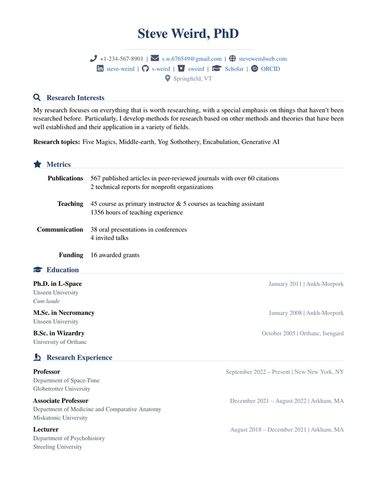

# CVAcademic - A latex template for an academic CV

This is a LaTex template for an academic CV. Entries are designed to
take key-value pairs.



### File structure

```
cvacademic/
├── cvacademic.cls        # Class file - contains definitions
├── main.tex              # Master document - sections are included from here
├── header.tex            # Personal information and socials
├── interests.tex         # Research interests and research keywords
├── highlights.tex        # Summary and highlights, metrics
├── education.tex         # Education entries
├── research.tex          # Research experience and academic positions
├── teaching.tex          # Teaching experience
├── software.tex          # Software packages and databases developed
├── publications.tex      # Articles, reports, preprints
├── presentations.tex     # Invited talks, presentations in conferences, posters
├── funding.tex           # Funded and unfinded research projects
├── awards.tex            # Awards and honors
├── service.tex           # Academic service including reviewing
├── Example/              # Example PDF and PNG
│   ├── main.png
│   └── main.pdf
├── README.md             # This file
└── LICENSE               # License file
```

### Installation

Just donwload the template from https://guthub.com/toni-am/cvacademic

You will probably also need TeXLive or MiKTeX for some of the package
requirements (see the `cls` file for a full list of required packages).

### Usage

Edit each of the `tex` files and include your information.
Add new entries using the `cventry` command or the `publication`
command (see below). Add or remove
sections by editing the `main.tex` file.
Add section and subsection
titles using the `cvsection` and `cvsubsection` commands, see below.
When done, compile with

```bash
pdflatex main.tex
pdflatex main.tex
```

## Customization

### Colors

Default colors are defined in the `cls` file (modify as needed):

```latex
\definecolor{cvprimary}{HTML}{1F3A5F}    % Primary color, for section titles, name
\definecolor{cvsecondary}{HTML}{4A5568}  % Secondary color, for subsection, personal info, body
\definecolor{cvaccent}{HTML}{2B6CB0}     % Accent color, for links, publication status
\definecolor{cvlight}{HTML}{718096}      % Light color, for dates, location
\definecolor{cvrule}{HTML}{CBD5E0}       % Rule color, for horizontal lines
```

### Margins and sizes

Default margins and layout size are defined in the `cls` (modify as needed):

```latex
\geometry{
  letterpaper,
  margin=0.75in,
  top=0.65in,
  bottom=0.65in
}
```

These can be overriden using a `\geometry` command with new parameter values 
in the `main.tex` file


## New commands

The `cls` file defines new commands for CV entries, publications, and section and subsection
titles.

### Sections

The new `cvsection` command takes two optional arguments and one mandatory argument:

```latex
\cvsection{style}{icon}{title}
   style : "regular" for the outline version of the icon, or empty for solid
   icon  : fontawesome5 icon name (e.g. graduation-cap), or empty for no icon
   title : section title
```
Icons sit in a fixed-width box so titles line up across sections.
Icons are dropped from the PDF bookmarks via \texorpdfstring.
Adjust \cvsectioniconwidth for a wider or narrower alignment column.

### Subsections

The new `cvsubsection` command only takes one mandatory argument:

```latex
\cvsubsection{title}
   title : subsection title
```
### Header

This will be displayed at the top of the document in structured lines.
All keys are optional; empty items and their separators are skipped.

```latex
\header{
   name        = your name (large, with a thin rule under it)
   phone       = phone number
   email       = email address
   website     = displayed text, e.g. yourwebsite.com (link: https://<value>)
   linkedin    = profile id, e.g. your-profile
   github      = user name, e.g. your-username
   bitbucket   = user name, e.g. your-username
   scholar     = Google Scholar user id
   orcid       = ORCID id (e.g. 0000-0000-0000-0000)
   location    = last line, with a map marker
   pdftitle, pdfsubject, pdfkeywords = PDF metadata (author = name)
 }
```
### Entry

The `cls` class defines a general use `entry` command, which displays the title in bold,
the subtitle in regular font, and the location and dates on the top right separated by a
`|` character. Even in long multiline title, the `date|location` data is displayed at the
top right of the entry. All keys are optional.

```latex
\entry{
  title       = First line in bold
  subtitle    = Second line in normal text
  credits     = Will appear next to the subtitle as X credits (or 1 credit)
  section     = will apear next to the credits or subtitle as X sections
  sections    = Same as section (alias)
  body        = Line in grey
  bodytwo     = Second line in grey
  date        = Can be single date or range (e.g. 2020 -- 2021}
  dates       = Same as date (alias)
  location    = Location, appears after date as date|location top right
  topic       = Appears as Topic: X
  lefticons   = List of names of fontawesome5 icons to appear left of title
  righticons  = List of names of fontawesome5 icons to appear right of title
  github      = Link to github, appears as icon at the bottom
  bitbucket   = Link to bitbucket, appears as icon at the bottom
  website     = Link to website, appears as icon at the bottom
  docs        = Link to documentation, appears as icon at the bottom
  article     = Link to published article, appears as icon at the bottom
  items       = Last line, in regular font (accepts TeX commands like itemize, etc.)
}
```
### Publication

The class file defines a specific entry commad for publications, which will appear using
the standard format for references. The key `type` defines the exact output format of the
entry.

```latex
\publication{
  type        = can be article (default), report, conference, or preprint
  authors     = List of authors
  title       = Title of the publication
  institution = Publisher (for reports)
  venue       = Name of the conference (for conference papers)
  journal     = Name of the journal (or the preprint service)
  year        = year of publciation
  volume      = volume of the publication
  issue       = issue or number of the publication
  pages       = can be a single number or a range
  doi         = Digital object iodentifier (e.g. {10.1111/jrh.12345})
  url         = Link to the publication, appears as icon
}
```
## License

This software is distributed under a MIT license.
